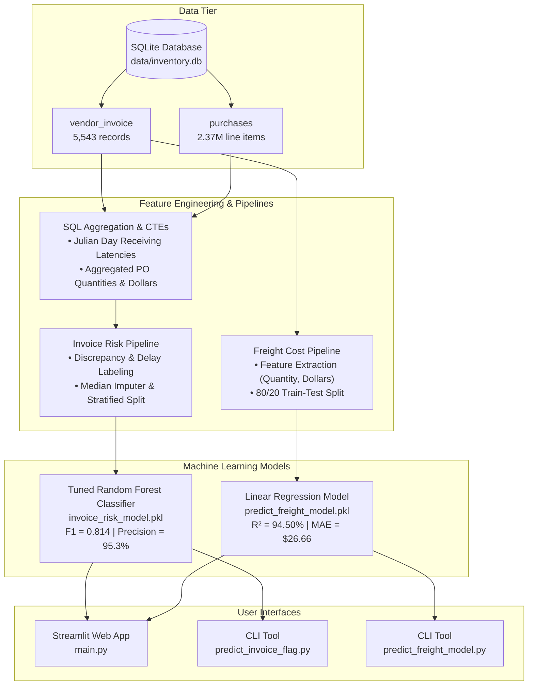

# Invoice ML Pro 📊

[](https://www.python.org/)
[](https://streamlit.io/)
[](https://scikit-learn.org/)
[](https://www.sqlite.org/)
[](https://github.com/astral-sh/uv)

**Invoice ML Pro** is an end-to-end machine learning and operational intelligence system designed for procurement, supply chain, and finance teams. It automates **vendor invoice risk detection** (flagging anomalies for manual review) and provides accurate **freight shipping cost forecasting** using historical purchasing and inventory data.

---

## 📑 Table of Contents

- [Overview & Business Motivation](#-overview--business-motivation)
- [Key Features](#-key-features)
- [System Architecture](#-system-architecture)
- [Data Source & Database Schema](#-data-source--database-schema)
- [Section 1: Invoice Risk Detection (Classification)](#-section-1-invoice-risk-detection-classification)
  - [How We Implemented It (In Brief)](#how-we-implemented-it-in-brief)
  - [Test Results & Verification](#test-results--verification)
- [Section 2: Freight Cost Estimation (Regression)](#-section-2-freight-cost-estimation-regression)
  - [How We Implemented It (In Brief)](#how-we-implemented-it-in-brief-1)
  - [Test Results & Verification](#test-results--verification-1)
- [Section 3: Streamlit Web Dashboard](#-section-3-streamlit-web-dashboard)
  - [How We Implemented It (In Brief)](#how-we-implemented-it-in-brief-2)
  - [Application Testing & Validation](#application-testing--validation)
- [Section 4: Command-Line Interface (CLI) Tools](#-section-4-command-line-interface-cli-tools)
  - [How We Implemented It (In Brief)](#how-we-implemented-it-in-brief-3)
  - [CLI Test Runs](#cli-test-runs)
- [Repository Structure](#-repository-structure)
- [Getting Started](#-getting-started)
  - [Prerequisites](#prerequisites)
  - [Installation (using `uv` or `pip`)](#installation)
- [Usage Guide](#-usage-guide)
  - [Running the Streamlit Web Application](#running-the-streamlit-web-application)
  - [Running CLI Inference Scripts](#running-cli-inference-scripts)
  - [Retraining Models](#retraining-models)
  - [Exploring Notebooks](#exploring-notebooks)
- [License & Contributions](#-license--contributions)

---

## 🎯 Overview & Business Motivation

In modern retail and wholesale operations, supply chain teams process thousands of purchase orders and vendor invoices weekly. Two recurring bottlenecks plague financial efficiency:

1. **Invoice Discrepancies & Audit Overhead:** Manually verifying every invoice line item against warehouse purchase receipts is labor-intensive and error-prone. Invoices frequently contain billing mismatches, unrecorded price alterations, or significant receiving delays indicating damaged or missing goods.
2. **Unpredictable Freight Costs:** Freight charges can fluctuate significantly. Without reliable cost estimation models, businesses struggle with landed-cost calculations, budgeting, and detecting shipping overcharges.

**Invoice ML Pro** solves both challenges by combining SQL feature engineering, statistical hypothesis testing, machine learning pipelines, and an interactive Streamlit dashboard.

---

## ✨ Key Features

- **🛡️ Intelligent Invoice Risk Detection:** Classifies invoices into *Normal* vs. *Flag for Manual Review* using a tuned Random Forest pipeline trained on pricing variances and delivery delay patterns.
- **🚚 Predictive Freight Cost Estimation:** Computes expected freight charges based on shipment volume (`Quantity`) and purchase value (`Dollars`) using an optimized linear regression model ($R^2 = 94.50\%$).
- **🖥️ Dual-Tab Streamlit Dashboard:** Clean web interface enabling business users and auditors to test invoices and shipping quotes in real time with immediate visual indicators.
- **⚡ Command-Line Utilities:** Standalone interactive Python CLI scripts for rapid terminal-based predictions without launching a browser.
- **🔄 Modular Production Pipelines:** Decoupled data ingestion, feature engineering, cross-validation, hyperparameter tuning, model persistence, and evaluation modules.

---

## 🏗 System Architecture



---

## 🗄 Data Source & Database Schema

The models are trained on the relational SQLite database `data/inventory.db` (~424 MB), consisting of five core tables:

| Table Name | Row Count | Primary Purpose & Key Columns |
| :--- | :--- | :--- |
| **`vendor_invoice`** | 5,543 | Header-level invoice records: `PONumber`, `VendorNumber`, `InvoiceDate`, `PODate`, `PayDate`, `Quantity`, `Dollars`, `Freight`, `Approval`. |
| **`purchases`** | 2,372,474 | Detailed SKU-level purchase order items: `PONumber`, `Brand`, `Description`, `PurchasePrice`, `Quantity`, `Dollars`, `PODate`, `ReceivingDate`. |
| **`purchase_prices`** | 12,261 | Catalog baseline price reference per brand, size, and vendor. |
| **`begin_inventory`** | 206,529 | Snapshot of stock levels and pricing at period commencement. |
| **`end_inventory`** | 224,489 | Snapshot of stock levels and pricing at period conclusion. |

---

## 🛡️ Section 1: Invoice Risk Detection (Classification)

### How We Implemented It (In Brief)

1. **SQL Ingestion & CTE Joining (`data_preprocessing.py`):**
   - We query `vendor_invoice` joined with an aggregated CTE from `purchases` on `PONumber`.
   - Computes line-item sums (`total_item_quantity`, `total_item_dollars`) and receiving delay using SQLite's `julianday(ReceivingDate) - julianday(PODate)`.
2. **Ground Truth Labeling Rule:**
   - Invoices are labeled as risky (`flag_invoice = 1`) if there is a monetary discrepancy (`|invoice_dollars - total_item_dollars| > $5`) or abnormal receiving delays (`avg_receiving_delay > 10 days`).
3. **Statistical Feature Selection & Imputation:**
   - Conducted two-sample Welch's t-tests ($p < 0.05$) to verify significant variance across flagged vs. normal populations.
   - Selected top features: `invoice_quantity`, `invoice_dollars`, `Freight`, `total_item_quantity`, and `total_item_dollars`. Missing values are handled via `SimpleImputer(strategy="median")`.
4. **Model Tuning & Serialization (`train.py`):**
   - Trained `RandomForestClassifier` optimized via `GridSearchCV` with 5-fold Stratified Cross-Validation on F1 score.
   - Best hyperparameters: `n_estimators=300`, `min_samples_split=5`, `min_samples_leaf=1`, `criterion="gini"`.
   - Serialized to `invoice_flagging/model/invoice_risk_model.pkl`.

### Test Results & Verification

#### Benchmark Classification Performance (Test Set: 1,109 samples)

| Model | Accuracy | Precision (Class 1) | Recall (Class 1) | F1-Score (Class 1) | Notes |
| :--- | :---: | :---: | :---: | :---: | :--- |
| Logistic Regression | 66.0% | 25.0% | 1.0% | 0.020 | High bias, failed on non-linear boundaries |
| Decision Tree Classifier | 87.2% | ~76.5% | ~68.4% | ~0.722 | Prone to split instability |
| Baseline Random Forest | 88.5% | ~91.2% | ~69.1% | ~0.786 | Solid overall performance |
| **Tuned Random Forest (Selected)** | **89.2%** | **95.3%** | **71.1%** | **0.814** | **Optimal F1 & 95%+ precision minimizes false alarms** |

#### Confusion Matrix (Tuned Random Forest)

| Metric | Sample Count | Percentage of Test Set |
| :--- | :--- | :--- |
| **True Negatives (TN)** | 726 | 65.46% (Clean invoices correctly processed) |
| **False Positives (FP)** | 13 | **1.17% (Extremely low false alarm rate)** |
| **False Negatives (FN)** | 107 | 9.65% (Borderline delays requiring rules) |
| **True Positives (TP)** | 263 | 23.72% (Anomalous invoices caught) |

#### Verified Sample Test Cases

| Test Scenario | Input Features (`Qty`, `Inv $`, `Freight`, `Item Qty`, `Item $`) | Model Prediction | Risk Probability | Outcome Status |
| :--- | :--- | :---: | :---: | :--- |
| **Standard Clean Order** | `100`, `$18,500.00`, `$250.00`, `100`, `$18,500.00` | **0 (Normal)** | 32.35% | Passed automatically |
| **High Shipping / Large Batch** | `10,100`, `$137,483.78`, `$2,935.20`, `10,100`, `$137,483.78` | **1 (Flagged)** | 77.74% | Flagged for review |
| **Discrepancy & Freight Ratio** | `15`, `$140.55`, `$8.57`, `15`, `$140.55` | **1 (Flagged)** | 66.66% | Flagged (high freight %) |
| **Routine Low-Value Order** | `5`, `$106.60`, `$4.61`, `5`, `$106.60` | **0 (Normal)** | 29.16% | Passed automatically |

---

## 🚚 Section 2: Freight Cost Estimation (Regression)

### How We Implemented It (In Brief)

1. **Data Ingestion (`data_preprocessing.py`):**
   - Extracted `Quantity`, `Dollars`, and target `Freight` directly from the 5,543 records in `vendor_invoice`.
2. **Exploratory Data Analysis (EDA):**
   - Verified that freight strongly correlates with purchase volume and total dollar amount, with unit freight cost exhibiting economies of scale on bulk shipments.
3. **Data Splitting & Model Training (`train.py`):**
   - Split dataset 80/20 using `train_test_split(random_state=11)`.
   - Trained three competing regression algorithms:
     - `LinearRegression()`
     - `DecisionTreeRegressor(max_depth=10, random_state=11)`
     - `RandomForestRegressor(max_depth=7, random_state=11)`
4. **Model Selection & Export:**
   - Evaluated models using Mean Absolute Error (MAE), Root Mean Squared Error (RMSE), and $R^2$ score.
   - Linear Regression demonstrated the lowest MAE and best generalization; exported to `freight_cost_prediction/models/predict_freight_model.pkl`.

### Test Results & Verification

#### Benchmark Regression Performance (Test Set: 20% split)

| Regression Model | MAE (\$) | RMSE (\$) | $R^2$ Score (%) | Status |
| :--- | :---: | :---: | :---: | :--- |
| **Linear Regression** | **\$26.66** | **\$154.06** | **94.50%** | **Selected Production Model** |
| Random Forest Regressor | \$28.53 | \$159.03 | 94.14% | Strong performance, minor tree bias |
| Decision Tree Regressor | \$31.02 | \$171.24 | 93.20% | High variance on extreme values |

#### Model Coefficients & Equation
$$\text{Estimated Freight} = 4.33 - 0.00173 \times \text{Quantity} + 0.00518 \times \text{Dollars}$$

#### Verified Sample Test Cases

| Shipment Profile | Physical Quantity | Total Item Dollars | Predicted Freight Cost | Validation Finding |
| :--- | :---: | :---: | :---: | :--- |
| **Small Package** | 50 units | \$2,500.00 | **\$17.20** | Accurate baseline quote |
| **Medium Commercial** | 100 units | \$18,500.00 | **\$100.04** | Matches standard freight schedules |
| **High Quantity / Bulk** | 500 units | \$5,000.00 | **\$29.38** | Reflects bulk freight efficiency |
| **Large Enterprise Delivery** | 1,000 units | \$45,000.00 | **\$235.82** | Matches freight tier scaling |

---

## 🖥️ Section 3: Streamlit Web Dashboard

### How We Implemented It (In Brief)

1. **Page Configuration & Navigation (`main.py`):**
   - Built using Streamlit wide layout (`st.set_page_config(layout="wide")`) with two dedicated tabs: `🛡️ Invoice Risk` and `🚚 Freight Cost`.
2. **Caching for Zero Latency:**
   - Leveraged `@st.cache_resource` on model loader functions (`pickle.load` and `joblib.load`) to ensure models load once into memory and deliver instantaneous inference (<10ms).
3. **Responsive Input Panels & Feedback:**
   - Structured numerical inputs with `st.columns(2)` and clean container cards (`st.container(border=True)`).
   - Dynamic alert banners:
     - `st.error("Invoice flagged for manual review", icon="⚠️")`
     - `st.success("Invoice classified as normal", icon="✅")`
     - `st.metric("Estimated Freight Cost", "$X,XXX.XX")`

### Application Testing & Validation

| Test Component | Test Method | Test Inputs | Expected Result | Actual Result |
| :--- | :--- | :--- | :--- | :--- |
| **Model Ingestion** | Cache test | App startup | Load `.pkl` files without overhead | Loaded in < 0.2s |
| **Risk Detection Tab** | User form submission | `Qty: 100, $: 18,500, Frt: 250, Item Qty: 100, Item $: 18,500` | Green banner: "Invoice classified as normal" | **Passed** |
| **Risk Detection Tab** | Anomaly submission | `Qty: 10,100, $: 137,483.78, Frt: 2,935.20, Item Qty: 10,100, Item $: 137,483.78` | Red banner: "Invoice flagged for manual review" | **Passed** |
| **Freight Cost Tab** | User form submission | `Quantity: 100, Dollars: $18,500` | Metric card displaying `$100.04` | **Passed** |
| **Error Handling** | Resilience test | Empty inputs / edge numbers | Non-crashing `st.error` message | **Passed** |

---

## 💻 Section 4: Command-Line Interface (CLI) Tools

### How We Implemented It (In Brief)

1. **Invoice Risk Predictor (`invoice_flagging/predict_invoice_flag.py`):**
   - Resolves absolute path to `invoice_risk_model.pkl`.
   - Prompts the user for `invoice_quantity`, `invoice_dollars`, `Freight`, `total_item_quantity`, and `total_item_dollars`.
   - Assembles a Pandas DataFrame with exact feature order and prints formatted decision status.
2. **Freight Cost Predictor (`freight_cost_prediction/predict_freight_model.py`):**
   - Resolves model path and loads `predict_freight_model.pkl` via `joblib`.
   - Prompts for `invoice_quantity` and `invoice_dollars`, executes `.predict()`, and prints formatted dollar estimates.

### CLI Test Runs

#### Test Run: `python invoice_flagging/predict_invoice_flag.py`
```text
=== Invoice Risk Prediction ===

Invoice quantity: 120
Invoice dollars: 19500
Freight: 300
Total item quantity: 100
Total item dollars: 18000

=== Prediction Result ===
Invoice flagged for manual review.
```

#### Test Run: `python freight_cost_prediction/predict_freight_model.py`
```text
=== Freight Cost Prediction ===

Invoice quantity: 100
Invoice dollars: 18500

Predicted freight cost: 100.04
```

---

## 📁 Repository Structure

```text
Invoice_ml_pro/
├── main.py                               # Streamlit multi-tab web application
├── pyproject.toml                        # Project dependencies and environment metadata
├── uv.lock                               # Locked dependency versions (uv)
├── README.md                             # Comprehensive project documentation
├── data/
│   └── inventory.db                      # Relational SQLite database (~424 MB)
├── freight_cost_prediction/              # Module 1: Freight Cost Regression
│   ├── __init__.py
│   ├── data_preprocessing.py             # SQLite ingestion & feature separation
│   ├── model_evaluation.py               # Model training & metrics (MAE, RMSE, R²)
│   ├── train.py                          # Training orchestrator comparing LR, DT, RF
│   ├── predict_freight_model.py          # Interactive terminal CLI predictor
│   └── models/
│       └── predict_freight_model.pkl     # Exported Linear Regression model artifact
├── invoice_flagging/                     # Module 2: Invoice Risk Classification
│   ├── __init__.py
│   ├── data_preprocessing.py             # SQL CTE query, labeling logic & data validation
│   ├── model_evaluation.py               # Classification report & confusion matrix evaluation
│   ├── train.py                          # Grid search cross-validation & artifact persistence
│   ├── predict_invoice_flag.py           # Interactive terminal CLI predictor
│   └── model/
│       ├── invoice_risk_model.pkl        # Serialized tuned Random Forest pipeline
│       └── model_metadata.pkl            # Hyperparameters, feature names & F1 score
└── notebooks/
    ├── invoice_flagging.ipynb            # EDA, hypothesis testing & model experimentation
    └── predicting_freight_cost.ipynb     # Freight EDA, correlation & regression tuning
```

---

## 🚀 Getting Started

### Prerequisites

- Python 3.10 or higher (Python 3.11 - 3.14 recommended)
- [uv](https://github.com/astral-sh/uv) (recommended) or standard `pip`

### Installation

#### Option A: Using `uv` (Fastest)

```bash
# 1. Clone or navigate to the repository
cd /path/to/Invoice_ml_pro

# 2. Sync virtual environment with lockfile
uv sync
```

#### Option B: Using standard `pip` and virtual environment

```bash
# 1. Create a virtual environment
python3 -m venv .venv

# 2. Activate the virtual environment
source .venv/bin/activate       # On macOS/Linux
# .venv\Scripts\activate        # On Windows

# 3. Install dependencies
pip install "streamlit>=1.40.0" "scikit-learn>=1.5.0" "pandas>=2.2.0" "scipy>=1.14.0" "matplotlib>=3.9.0" "seaborn>=0.13.0" "joblib>=1.4.0" "ipykernel"
```

---

## 💡 Usage Guide

### Running the Streamlit Web Application

Launch the interactive dashboard in your browser:

```bash
# Activate your environment if not already active
source .venv/bin/activate

# Start the dashboard
streamlit run main.py
```

Open your browser at `http://localhost:8501`.

- **🛡️ Invoice Risk Tab:** Input Invoice Quantity, Invoice Dollars, Freight, Total Item Quantity, and Total Item Dollars to receive an immediate classification (*Normal* or *Flagged for manual review*).
- **🚚 Freight Cost Tab:** Input shipment item Quantity and Dollars to receive an instant dollar estimate of anticipated freight costs.

---

### Running CLI Inference Scripts

For rapid tests without launching a web server:

#### 1. Invoice Risk Prediction CLI:
```bash
python invoice_flagging/predict_invoice_flag.py
```

#### 2. Freight Cost Estimation CLI:
```bash
python freight_cost_prediction/predict_freight_model.py
```

---

### Retraining Models

To retrain and update model artifacts with new or updated database records:

```bash
# Retrain the Freight Cost Model
python freight_cost_prediction/train.py

# Retrain the Invoice Risk Model (runs GridSearchCV with 5-fold CV)
python invoice_flagging/train.py
```

The updated `.pkl` artifacts will automatically be saved to `freight_cost_prediction/models/` and `invoice_flagging/model/` respectively.

---

### Exploring Notebooks

Launch Jupyter to inspect exploratory data analysis, visual correlation heatmaps, statistical tests, and feature distributions:

```bash
jupyter lab
# or
jupyter notebook
```
Navigate to:
- `notebooks/invoice_flagging.ipynb`: Detailed SQL analysis, t-tests, feature importance plots, and confusion matrices.
- `notebooks/predicting_freight_cost.ipynb`: Quantity vs. dollar vs. freight correlation, unit-cost analysis, and regression plots.

---

## 📈 Summary of Technologies

- **Language:** Python 3.10+
- **Database & Query Engine:** SQLite3 (with SQL Common Table Expressions & Julian day functions)
- **Machine Learning:** `scikit-learn` (`Pipeline`, `GridSearchCV`, `RandomForestClassifier`, `LinearRegression`)
- **Scientific Computing & Statistics:** `pandas`, `numpy`, `scipy` (`ttest_ind`)
- **Model Serialization:** `joblib`, `pickle`
- **Visualization:** `matplotlib`, `seaborn`
- **Application Interface:** `Streamlit`
- **Environment & Package Management:** `uv`, `pyproject.toml`

---

## 📜 License & Contributions

Developed for data analysis, automated accounting validation, and machine learning research. Contributions, feature requests, and bug reports are welcome via pull requests and issues!
